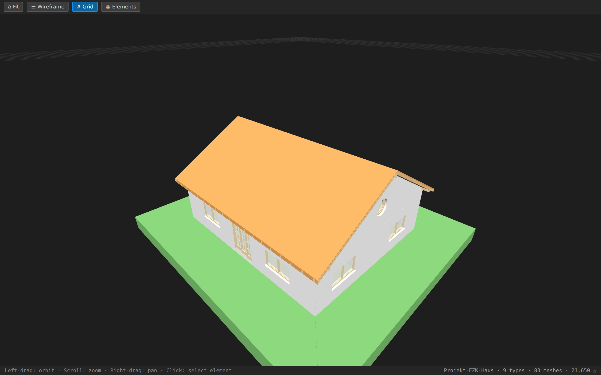

# Revit Viewer — open Revit & IFC models in VS Code

[](https://marketplace.visualstudio.com/items?itemName=bumkom.revit-preview)
[](LICENSE)

**Open Revit models in 3D, right inside VS Code.** Double-click a `.rvt` file (read directly — no Revit install required) or an `.ifc` file exported from Autodesk Revit, and explore the building interactively: orbit, zoom, hide element types, click any wall, slab or door to read its properties. No cloud upload, no plugins.


## ✨ Features

- **Open `.rvt` directly** — an open-source clean-room reader (rvt-rs, Apache-2.0) decodes Revit files on your machine and renders them as 3D; full geometry for Revit 2023–2025 projects, metadata for every release 2016–2027, with a per-stage progress bar
- **Open `.ifc`** — the openBIM format Revit exports natively; best fidelity for measurement/coordination work
- **Interactive 3D viewport** — orbit / zoom / pan, built on three.js with WebGL
- **Element list panel** — every element type grouped with counts (walls, slabs, columns, doors, windows, stairs, railings…), with visibility toggles, isolate, and text filtering
- **Click to select** — pick an element in 3D to highlight it and show its properties (Type, GlobalId, Name, Tag, IFC attributes) in an inspector panel
- **Toolbar** — fit view, wireframe toggle, ground grid toggle
- **Status bar** — project name, type count, mesh count, triangle count
- **VS Code native** — docked panels, theme-aware colors, works in split editors; registered as the default viewer for `*.ifc` and `*.rvt`
- **100% local** — all parsing runs in the editor via WASM; your models never leave your machine

## 📷 Gallery

| | |
|---|---|
|  |  |

## 🚀 Getting a model to view

### Option A — open `.rvt` directly (v2.0)

Just open the file: double-click `model.rvt` in VS Code. The extension decodes it locally.

- Full 3D geometry: **Revit 2023–2025** projects (2026/2027 experimental)
- Metadata only (version, build, worksharing…): every Revit release 2016–2027
- Older files get a clear message pointing to Option B
- Quality note: the reader is clean-room reverse-engineered — great for quick preview; for measurement-grade data use Option B

### Option B — export IFC from Revit (best fidelity)

1. Open your `.rvt` model in Autodesk Revit
2. **File → Export → IFC** (use the *IFC 4 Design Transfer View* MVD to keep the most geometry)
3. Open the exported `.ifc` in VS Code — it opens in the 3D viewer automatically

## 📖 Usage

| Action | How |
|---|---|
| Open a model | Double-click a `.ifc` or `.rvt` file (or right-click → *Open With…* → Revit Viewer) |
| Orbit / zoom / pan | Left-drag / scroll / right-drag |
| Select an element | Click it in 3D — or use the Elements panel |
| Hide a type | ◉ button next to its row in the Elements panel |
| Isolate a type | ⌖ button — shows only that type |
| Wireframe / grid / fit | Toolbar buttons |

## 🛠️ Development

```bash
npm install
npm run compile     # build dist/ + media/ (esbuild)
npm run watch       # rebuild on change
npm run typecheck   # tsc --noEmit
npm run smoke       # end-to-end test on samples/ (.rvt → IFC → real viewer, headless)
```

Debug: press **F5** to launch the Extension Development Host, then open a `.ifc` file.

Regenerate the marketplace screenshots (runs the real webview UI headlessly with the FZK-Haus sample):

```bash
node scripts/screenshot.js
```

Package for distribution:

```bash
npx vsce package    # → revit-preview-<version>.vsix
code --install-extension revit-preview-<version>.vsix
```

## 🧱 How it works

```
Revit (.rvt) ──rvt-wasm (local, in worker)──► IFC4 ──┐
                                                     ├──web-ifc (WASM)──► three.js 3D in a VS Code webview
Revit (.rvt) ──Revit Export IFC────────────► .ifc ──┘
```

- `src/` — extension host: registers the custom editors, converts `.rvt` in a worker thread, streams the file into the webview
- `webview/` — the viewer: three.js scene, web-ifc parsing, element panel, inspector
- `vendor/rvt-wasm/` — the open-source Revit reader ([rvt-rs](https://github.com/DrunkOnJava/rvt-rs), Apache-2.0)
- `scripts/` — screenshot harness (runs the real webview outside VS Code)

## 🗺️ Roadmap

- [ ] Section cut (clipping planes)
- [ ] Full property sets (psets/quantities)
- [ ] Model comparison view

## 📄 License

MIT — see [LICENSE](LICENSE). Third-party: three.js (MIT), web-ifc (Apache-2.0), rvt-rs (Apache-2.0). "Revit" is a trademark of Autodesk, Inc.; this extension is independent and not affiliated with or endorsed by Autodesk.
