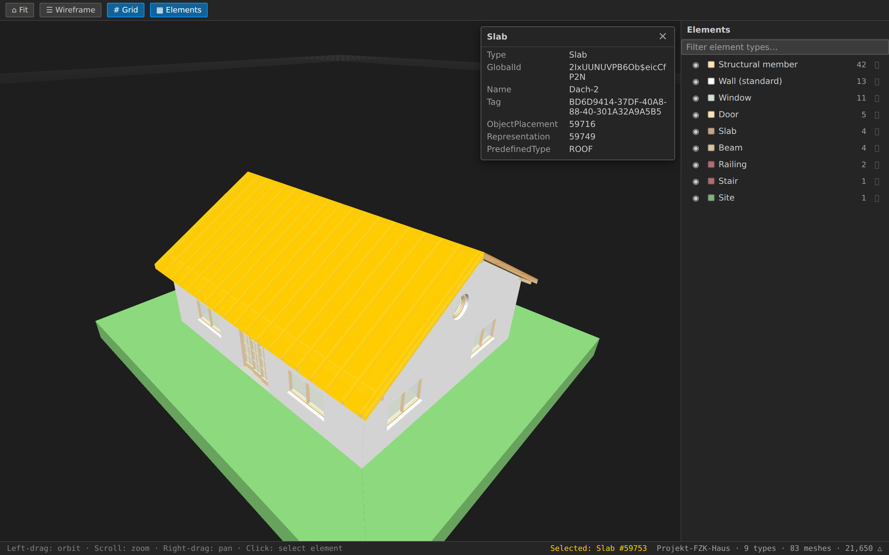
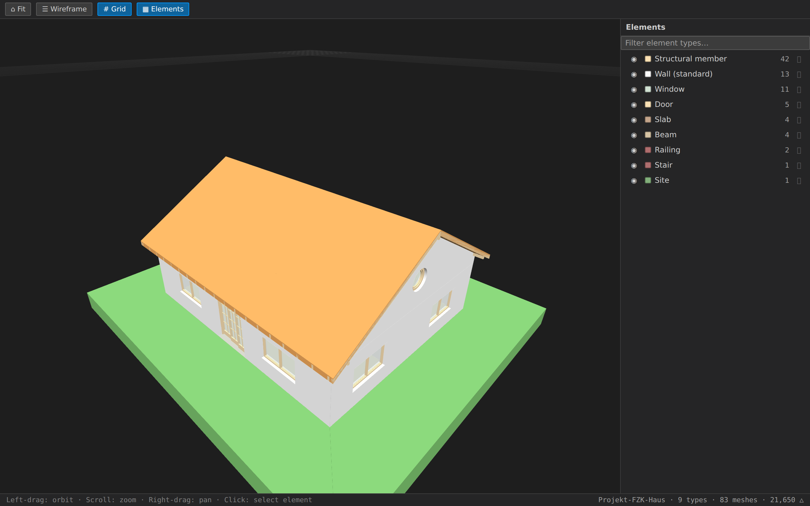

# Revit Preview — IFC 3D Viewer for VS Code

[](https://marketplace.visualstudio.com/items?itemName=bumkom.revit-preview)
[](LICENSE)

**Preview Revit models in 3D, right inside VS Code.** Open an IFC file exported from Autodesk Revit and explore the building interactively — orbit, zoom, hide element types, click any wall, slab or door to read its properties. No Revit install, no plugins, no cloud upload.



## ✨ Features

- **Interactive 3D viewport** — orbit / zoom / pan, built on three.js with WebGL
- **Element list panel** — every element type grouped with counts (walls, slabs, columns, doors, windows, stairs, railings…), with visibility toggles, isolate, and text filtering
- **Click to select** — pick an element in 3D to highlight it and show its properties (Type, GlobalId, Name, Tag, IFC attributes) in an inspector panel
- **Toolbar** — fit view, wireframe toggle, ground grid toggle
- **Status bar** — project name, type count, mesh count, triangle count
- **VS Code native** — docked panels, theme-aware colors, works in split editors; registered as the default viewer for `*.ifc`
- **100% local** — parsing runs in the editor via WASM (web-ifc); your model never leaves your machine

## 📷 Gallery

| | |
|---|---|
|  |  |

## 🚀 Getting a model to view

The extension opens **IFC** files — the openBIM format Revit exports natively:

1. Open your `.rvt` model in Autodesk Revit
2. **File → Export → IFC** (use the *IFC 4 Design Transfer View* MVD to keep the most geometry)
3. Open the exported `.ifc` in VS Code — it opens in the 3D viewer automatically

> ℹ️ `.rvt` is a closed Autodesk format that cannot be read directly. The IFC export step takes one click in Revit and gives the best fidelity. Direct `.rvt` support is on the roadmap.

## 📖 Usage

| Action | How |
|---|---|
| Open a model | Double-click a `.ifc` file (or right-click → *Open With…* → Revit Preview) |
| Orbit / zoom / pan | Left-drag / scroll / right-drag |
| Select an element | Click it in 3D — or use the Elements panel |
| Hide a type | ◉ button next to its row in the Elements panel |
| Isolate a type | ⌖ button — shows only that type |
| Wireframe / grid / fit | Toolbar buttons |

## 🛠️ Development

```bash
npm install
npm run compile     # build dist/ + media/ (esbuild)
npm run watch       # rebuild on change
npm run typecheck   # tsc --noEmit
```

Debug: press **F5** to launch the Extension Development Host, then open a `.ifc` file.

Regenerate the marketplace screenshots (runs the real webview UI headlessly with the FZK-Haus sample):

```bash
node scripts/screenshot.js
```

Package for distribution:

```bash
npx vsce package    # → revit-preview-<version>.vsix
code --install-extension revit-preview-<version>.vsix
```

## 🧱 How it works

```
Revit (.rvt) ──Export IFC──► .ifc ──web-ifc (WASM)──► three.js 3D in a VS Code webview
```

- `src/` — extension host: registers the custom editor, streams the file into the webview
- `webview/` — the viewer: three.js scene, web-ifc parsing, element panel, inspector
- `scripts/` — screenshot harness (runs the real webview outside VS Code)

## 🗺️ Roadmap

- [ ] Direct `.rvt` reading via open-source parsers (clean-room projects now exist)
- [ ] Section cut (clipping planes)
- [ ] Full property sets (psets/quantities)
- [ ] Model comparison view

## 📄 License

MIT — see [LICENSE](LICENSE). Third-party: three.js (MIT), web-ifc (Apache-2.0). "Revit" is a trademark of Autodesk, Inc.; this extension is independent and not affiliated with or endorsed by Autodesk.
